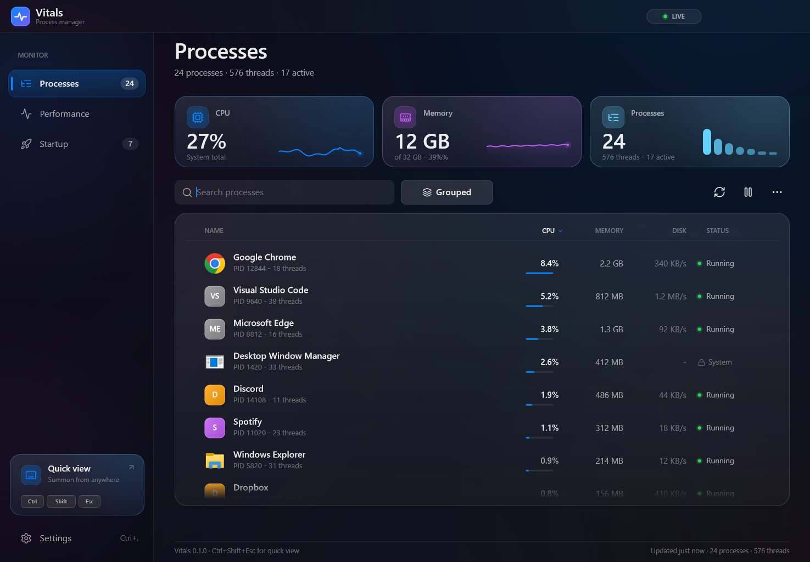
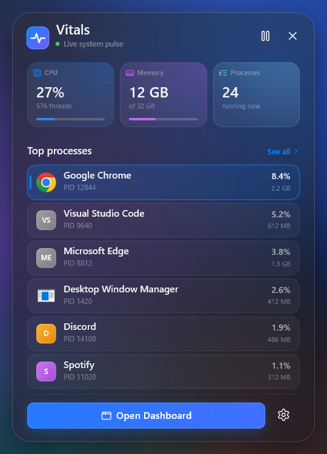
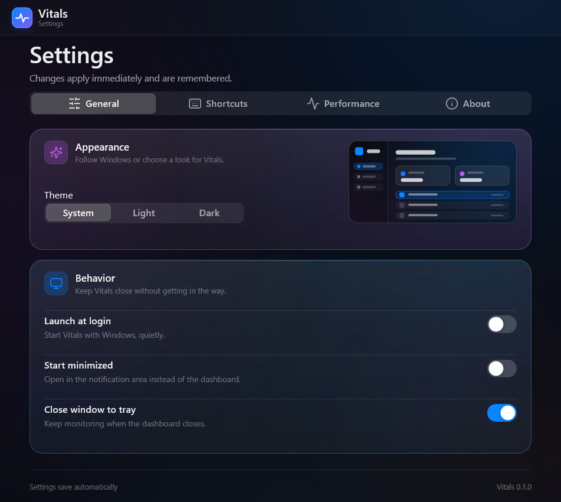
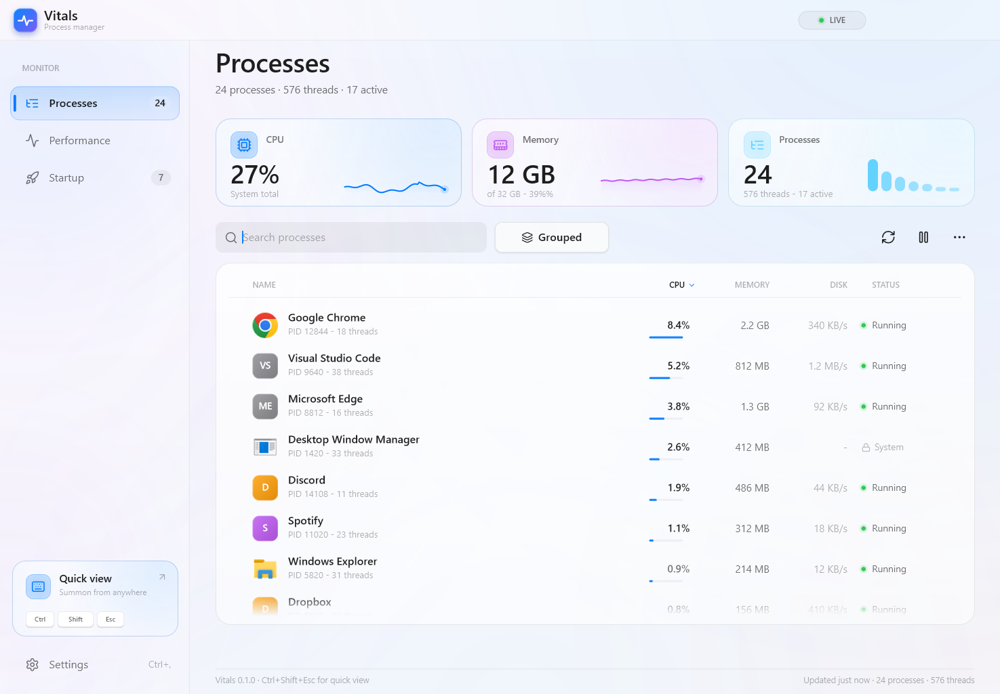

<p align="center"></p>

<h1 align="center">Vitals</h1>

<p align="center">A calm, fast process manager for Windows 11.<br>
One shortcut, three focused surfaces, no telemetry and no browser runtime.</p>

<p align="center">
  
</p>

Vitals is an independent process manager built on the visual language of [Glint](https://github.com/joxan2137/glint)
and [Tuck](https://github.com/joxan2137/tuck). It replaces Task Manager's default shortcut while it runs, samples the
system into a compact Rust model, and gets out of the way when you are done.

## What it does

- **Ctrl+Shift+Esc, reimagined.** A low-level keyboard hook opens the quick view over any app. Ctrl+Alt+Esc is also
  covered when the legacy shortcut option is on. Windows gets both shortcuts back the moment Vitals exits.
- **Apps first, processes when you need them.** The dashboard groups windows and helpers by app, expands to individual
  processes, sorts by CPU, memory, disk or name, and searches instantly.
- **Actions that respect the system.** End task (with confirmation by default), suspend and resume, priority changes,
  reveal in Explorer and copy details. Protected Windows processes are reported instead of silently failing.
- **A real performance page.** Live CPU history across all cores, memory pressure, and the top consumers in one calm
  view.
- **Startup inventory.** Reads per-user and machine Run entries and both startup folders, shows the resolved command,
  and toggles entries through the same `StartupApproved` state Task Manager uses. All-users changes report a clear
  administrator-rights error instead of failing silently.
- **A quick view built for a shortcut.** Six busiest processes, live totals, pause sampling, settings, and one click to
  open the full dashboard or jump to a process.
- **Native Windows 11 details.** Mica and transient acrylic backdrops, per-monitor DPI, rounded corners, system
  light/dark mode, reduced-motion support, shell icons and a notification-area menu.
- **Local and per-user.** No network code, no account, no telemetry. Settings live in `%APPDATA%\Vitals`, logs in
  `%LOCALAPPDATA%\Vitals`, and installation needs no elevation.

<p align="center">
  
  
</p>

<p align="center">
  
</p>

## Shortcuts

| Keys | Where | Action |
|---|---|---|
| `Ctrl+Shift+Esc` | Global | Open or close the quick view |
| `Ctrl+Alt+Esc` | Global, optional | Open or close the quick view (legacy Task Manager alias) |
| `Ctrl+1` / `Ctrl+2` / `Ctrl+3` | Dashboard | Processes / Performance / Startup |
| `Ctrl+F` | Dashboard | Focus search and select its text |
| `Ctrl+R` or `F5` | Dashboard | Sample again now |
| `Ctrl+,` | Dashboard | Open settings |
| `Ctrl+W` | Dashboard | Close the dashboard (to tray by default) |
| `Up` / `Down` | Dashboard | Move selection |
| `Left` / `Right` | Dashboard | Collapse / expand an app group |
| `Esc` | Dashboard | Clear search, clear selection, then close |
| `Esc` | Quick view | Close |
| `Ctrl+1` … `Ctrl+4` | Settings | Switch tabs |
| `Ctrl+W` or `Esc` | Settings | Close settings |

The close-window-to-tray, start-minimized, launch-at-login, shortcut ownership, sampling period and confirmation
behavior are all configurable. Settings changes take effect immediately.

## Install

Download the latest prebuilt Windows x64 zip from the [latest release](../../releases/latest), extract it, and run:

```powershell
.\vitals.exe --install
```

The release build is unsigned, so Windows SmartScreen may warn. To build from source instead, use the MSVC toolchain:

```powershell
cargo build --release -p vitals-app
.\target\release\vitals.exe --install
```

`--install` copies `vitals.exe` to `%LOCALAPPDATA%\Programs\Vitals`, registers a per-user **Apps & Features** entry,
enables launch at login, and starts the app in the notification area. No administrator rights are required.

```powershell
vitals --background          # stay in the tray, no dashboard
vitals --quit                # ask the running copy to exit
vitals --uninstall           # remove the app and autostart entry
vitals --uninstall --purge   # also remove settings and logs
vitals --version
```

Running the executable without arguments opens the dashboard. Starting a second copy activates the existing one
instead of creating another tray icon.

## Build and test

```powershell
cargo check --workspace --all-targets
cargo clippy --workspace --all-targets
cargo build --release -p vitals-app
.\target\release\vitals.exe --selftest
.\target\release\vitals.exe --preview previews
```

`--selftest` is non-destructive: it exercises the model, settings, live sampler and all three render paths without
ending or modifying another process. `--preview` writes deterministic PNGs at 1.25× scale, including dark and light
versions of every tab.

## Architecture

```
vitals/
├─ crates/
│  ├─ vitals-core     pure model, settings, geometry, formatting
│  ├─ vitals-proc     sampling, process actions, startup inventory
│  ├─ vitals-ui       Direct2D/DirectWrite kit, widgets, windows, motion
│  ├─ vitals-sys      keyboard hook, tray, single instance, registry, shell
│  ├─ vitals-panel    dashboard, quick view and settings views (pure UI)
│  └─ vitals-app      resident runtime, CLI, previews and selftest
├─ docs/              design notes and screenshots
└─ tools/             reproducible icon generation
```

The dependency direction is deliberate:

```
vitals-app ──> vitals-panel ──> vitals-core
     │              │
     │              └────────> vitals-ui
     ├─────────────> vitals-proc ──> vitals-core
     └─────────────> vitals-sys  ──> vitals-core
```

`vitals-panel` never opens a process or touches a registry key. Every command leaves as a `PanelIntent`, and the app
turns that intent into a PID-scoped Win32 operation. The UI therefore stays testable and previewable offscreen.

The resident app owns one sampler thread, one tray icon and one keyboard-hook thread. Windows are created lazily and
hidden rather than destroyed, so reopening is instant. See [`crates/vitals-ui/API.md`](crates/vitals-ui/API.md) for
the render kit contract and [`NOTICE.md`](NOTICE.md) for upstream attribution.

## Privacy and safety

- No network access, analytics, accounts or cloud storage.
- Settings and logs stay under the current user's profile.
- Destructive actions are confirmed by default and are always scoped to the PID that was sampled.
- Vitals cannot end protected Windows processes; operations that need more privilege fail with a readable notice.
- Quitting from the tray removes the hook and returns Task Manager's shortcuts to Windows.

## License

Vitals is MIT licensed. The design language and render kit are adapted from Glint and Tuck by **joxan2137**, also MIT
licensed, copyright © 2026. See [`LICENSE`](LICENSE) and [`NOTICE.md`](NOTICE.md) for the full attribution.
